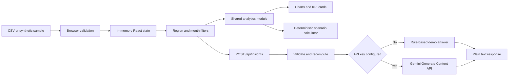

# Insight BI · Group 8 · Division B · Batch B3

## GenAI Powered Business Intelligence and Strategic Insight Generation System

A college mini project that turns CSV sales data into business dashboards, grounded explanations, and strategic what-if scenarios.

**Group 8 · Division B · Batch B3 · K.J Somaiya School of Engineering · IT (AI & DS) · 2026–2027**

| Team member | Roll number |
|---|---|
| Vruddhi Mule | 16014223099 |
| Rajdeep Pandey | 16014223064 |
| Sagar Jadhav | 16014223070 |


## What works

- Revenue, gross profit, gross margin, orders, and average order value.
- Monthly revenue/profit chart and revenue share by product category.
- Region and date filters; searchable, paginated data explorer.
- CSV upload with strict validation, sample download, and filtered export.
- Live Gemini answers through a server-side endpoint, already enabled on the Render website.
- Calculated insight cards and a local demo mode for copies without an API key.
- Price, volume, and unit-cost scenarios with transparent formulas.
- Downloadable business reports; editable academic project report and PDF.
- Responsive desktop and mobile layouts, labeled controls, keyboard support.

**Gemini is already connected on the [live Render website](https://insight-bi-group8.onrender.com).** Faculty and visitors can open **AI insights** and ask questions without entering an API key. The service uses `gemini-3.5-flash-lite`; a live smoke test returned the correct sample revenue (INR 4,941,991), gross profit (INR 1,382,887), and leading category (Electronics). Provider requests, failure handling, and one bounded retry are also tested with mocks. Generated answers still require human verification. This is not a trained custom ML model, RAG system, or predictive forecasting engine.

## Run locally

Install Node.js **22.13 or newer** (Node 22 LTS recommended) and npm.

```bash
git clone https://github.com/vru9/genai-business-intelligence.git
cd genai-business-intelligence
npm ci
npm run dev
```

Open the local address printed in the terminal (normally `http://127.0.0.1:5173`). A fresh local copy starts in rule-based demo mode until you configure your own Gemini key. No API key or database is needed for that local sample demo. Uploads are held in memory and reset when you refresh.

### Gemini setup for local development only

**The hosted Render application is already configured. No setup is needed to use the website.** The following steps are only for developers running a separate copy on their own computer; the deployed API key is kept private on Render and is not included in GitHub.

1. Obtain a Gemini API key through [Google AI Studio](https://aistudio.google.com/apikey).
2. Copy `.dev.vars.example` to `.dev.vars` in the project root.
3. Set `GEMINI_API_KEY` and a model available to your Google account. `GEMINI_MODEL` defaults to [`gemini-3.5-flash-lite`](https://ai.google.dev/gemini-api/docs/models/gemini-3.5-flash-lite). Override it if your account uses another supported model.
4. Restart the dev server. The interface should show **Gemini connected**.

```dotenv
GEMINI_API_KEY=your_key_here
GEMINI_MODEL=gemini-3.5-flash-lite
```

`.dev.vars` is ignored by Git. Never put a real key in `.dev.vars.example`, frontend code, screenshots, or commits. The deployed application's key is already saved in Render's **Environment** settings and stays on the server. API usage and billing depend on the provider account.

For the Next.js/Render runtime on your computer, copy `.env.example` to `.env.local` instead. Next.js loads `.env.local`; the Vinext local preview uses `.dev.vars`. Neither secret file is committed.

The browser sends the selected records to this app's backend on an explicit question. The backend validates them and recomputes the metrics. Only the question and calculated summaries go to Gemini. Responses are rendered as text, with no executable model-generated HTML. Dataset labels are treated as untrusted context in the prompt.

## CSV format

A complete example is [data/sample-retail-data.csv](data/sample-retail-data.csv).

```csv
date,category,region,channel,revenue,cost,orders
2025-01-10,Electronics,West,Online,100000,72000,50
2025-02-10,Furniture,East,Retail,80000,64000,20
```

| Column | Rule |
|---|---|
| `date` | Required, real `YYYY-MM-DD` date between 1900 and 2100 |
| `category` | Required, 1–80 characters |
| `region` | Required, 1–80 characters |
| `channel` | Optional; defaults to `Direct` when column is absent |
| `revenue` | Required, non-negative amount in INR |
| `cost` | Required, non-negative amount in INR |
| `orders` | Required, non-negative whole number |

Limit: 2 MB, 10,000 rows, 50 distinct values per grouping dimension, and at most 3,660 days of coverage. Numeric values are capped at 1 trillion per row. Quoted commas and escaped quotation marks are supported. Invalid rows reject the entire upload with an error; the previous dataset is preserved. Duplicate rows are not automatically removed, because identical aggregate records can be legitimate. Negative values and returns are outside this version's schema.

A row can represent a transaction or an aggregate. `orders` is summed, not inferred from row count. All rows must use a consistent currency and cost definition. Formula-like text labels are escaped when exporting CSV to reduce spreadsheet formula execution.

## Architecture



The application uses React and TypeScript with Next.js App Router. Render runs the Next.js build as a Node.js web service. The existing Sites preview uses Vinext's App Router compatibility, Vite, and Cloudflare Workers, with the integration in `vite.config.ts`. Both runtimes use the same UI, API route, analytics, and Gemini code. There is no application database or dataset persistence in this version. Unused storage/UI scaffolding comes from the hosting starter.

## Important files

| Path | Purpose |
|---|---|
| `app/page.tsx` | Dashboard, explorer, AI chat, scenarios, project guide |
| `app/globals.css` | Responsive layout and visual styling |
| `lib/analytics.ts` | CSV parsing, validation, sample data, KPIs, demo rules, scenarios |
| `lib/ai.ts` | Grounded provider request and demo mode routing |
| `app/api/insights/route.ts` | Same-origin API and runtime configuration |
| `tests/analytics.test.mjs` | Automated analytics and provider contract tests |
| `docs/project-report.docx` | Editable academic project report |
| `docs/project-report.pdf` | PDF academic project report |
| `scripts/build-report.py` | Reproducible report authoring source |
| `render.yaml` | Free Node web service, build/start commands, health check |
| `scripts/start-render.mjs` | Next.js server listening on Render's PORT |

## Calculations

- Revenue = sum of revenue; cost = sum of cost.
- Gross profit = revenue − cost; gross margin = gross profit / revenue × 100.
- Average order value = revenue / orders.
- Latest month growth compares only consecutive calendar months; it is unavailable when the previous month is absent or has zero revenue.
- Scenario revenue = revenue × (1 + price change) × (1 + volume change).
- Scenario cost = cost × (1 + volume change) × (1 + unit cost change).
- Scenario gross profit = scenario revenue − scenario cost.

Percentage inputs are divided by 100. Zero revenue/order denominators display zero to keep the UI finite; interpret these cases as unavailable ratios. Gross profit is not net profit unless the supplied cost field includes all relevant expenses. In the scenario model all recorded costs scale with volume; fixed costs and price elasticity are not modeled. Monthly data can be incomplete. The default synthetic dataset has 288 records from January–June 2025; it is not evidence of real company performance.

## Verify and build

```bash
npm test
npm run typecheck
npm run build
npm start
```

The automated suite has 15 tests covering aggregations, date filtering, CSV parsing and validation, zero-data behavior, missing months, scenario math, export escaping, size limits, demo answers, mocked Gemini requests, provider errors, and bounded retry recovery. Browser checks include upload, search, region filtering, AI demo and live Gemini responses, scenario adjustment/reset, export, and responsive layout. One live summary misstated average order value as INR 1,277.52 instead of the calculated INR 1,227.52. Always check generated figures against deterministic dashboard values. Formal answer-quality evaluation and load testing remain future validation tasks.

For the Render/Node production runtime:

```bash
npm run build:render
npm run start:render
```

The Node server listens on `0.0.0.0` and reads `PORT` (default `10000`). Open `http://localhost:10000` locally. CI checks both hosting builds.

## Demonstration for faculty

1. Open Overview and explain the four KPIs.
2. Select West and show that every chart and insight uses the same filtered data.
3. Open Data explorer, upload the sample CSV, and search for Furniture.
4. On the Render website, open AI insights and choose “Summarize business performance.” Show the **Gemini response** label and compare the generated figures with the dashboard.
5. Open Strategy lab and change price/volume assumptions; reset to reproduce baseline values.
6. Export the business report and explain why a scenario is not a forecast.
7. Review the test suite and project report.

## Hosting and access

### Render deployment

Public application: [Insight BI on Render](https://insight-bi-group8.onrender.com)

The application is deployed as a **Free** Node web service in Singapore with Gemini configured. The repository includes `render.yaml` for reproducing the deployment. The current service uses these settings:

| Setting | Value |
|---|---|
| Repository | `https://github.com/vru9/genai-business-intelligence` |
| Branch | `main` |
| Runtime | Node |
| Build command | `npm ci --include=dev && npm run build:render` |
| Start command | `npm run start:render` |
| Health check | `/api/insights` |
| Node version | `22.18.0` |
| Instance type | Free |

`GEMINI_API_KEY` and `GEMINI_MODEL=gemini-3.5-flash-lite` are already configured in the current service's **Environment** settings. If you create a separate deployment, configure your own key there. Model access, quota, and provider availability affect live answers. Render's free services sleep after 15 minutes without traffic, so allow time for the first request after inactivity. See [Render's free service documentation](https://render.com/docs/free).

The current service was created from the public repository URL. Check the Render **Deploys** page after pushing changes; **Manual Deploy → Deploy latest commit** is available when a fresh deployment is needed. The repository's Blueprint requests deployment after CI checks pass.

## Academic report

Read [the PDF report](docs/project-report.pdf) or edit [the Word report](docs/project-report.docx). The report distinguishes implemented features, verified results, assumptions, and future work. A successful live Gemini smoke test is recorded separately from formal answer-quality evaluation, which remains future work. No forecasting accuracy is claimed.

## References

- [Google Gemini Generate Content API](https://ai.google.dev/api/generate-content)
- [React documentation](https://react.dev/learn)
- [TypeScript handbook](https://www.typescriptlang.org/docs/handbook/intro.html)
- [Cloudflare Workers documentation](https://developers.cloudflare.com/workers/)
- [Node.js test runner](https://nodejs.org/api/test.html)
